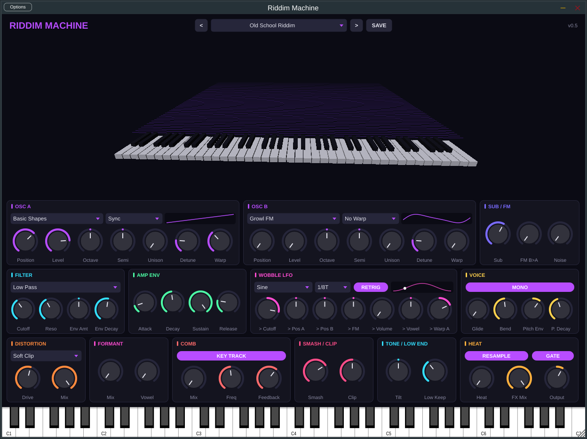
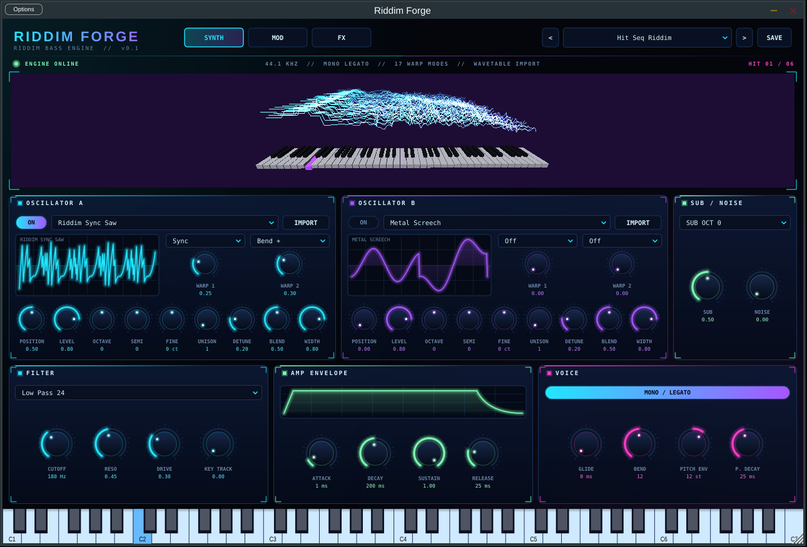
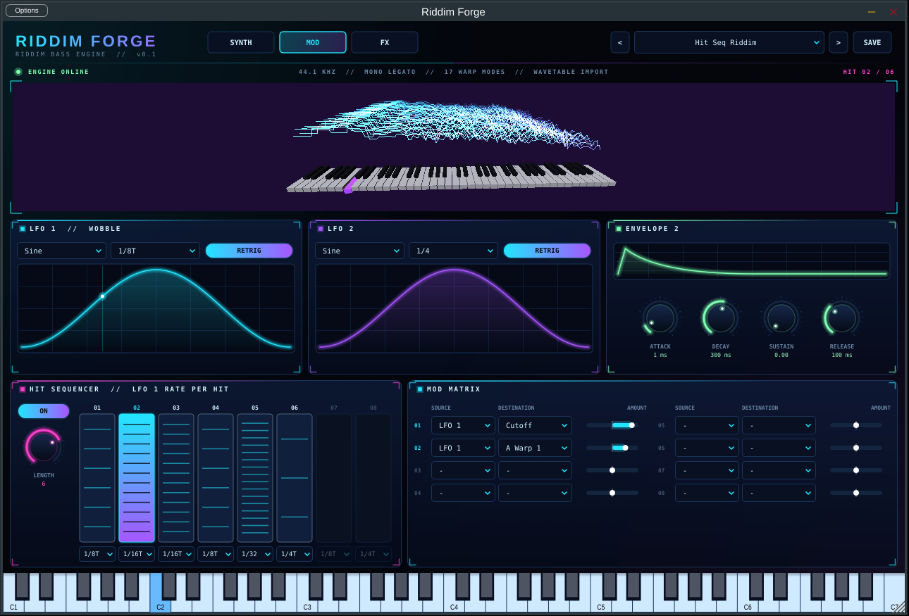
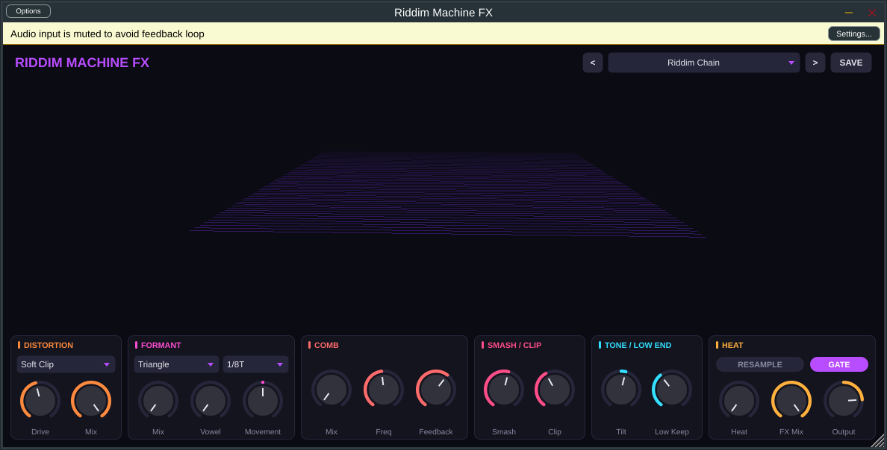

# Riddim Machine

Two riddim/dubstep synth plugins and a matching FX plugin, built with JUCE 8 (C++17) and CMake.
Both build as VST3 and Standalone on Windows, macOS and Linux, plus AU on macOS.



## Riddim Machine (synth)

- **3D view**: an OpenGL keyboard (C1 to C7) whose keys dip and glow with the notes being
  played, in front of a scrolling spectrum terrain driven by the output. Drag to orbit, scroll
  to zoom, double-click to reset.
- **Two wavetable oscillators** with 8 built-in tables (16 morph frames each, band-limited so
  high notes don't alias): Riddim Sync Saw, Growl FM, Yoi Formant, Tearout Fold, Metal Screech,
  Pulse Width, Reese Stack, Basic Shapes. Position, level, octave, semitone, unison (1 to 5)
  and detune per oscillator, with a live preview of the current frame.
- **Phase warp** per oscillator, the Serum-style trick behind most riddim tones: Sync (hard
  sync sweep), Bend, Mirror and Quantize (bit-step), with a Warp amount the Wobble LFO can
  drive on oscillator A (`> Warp A`).
- **Sub sine** on the note's fundamental, **FM (B into A) and noise.**
- **Filter**: low pass, band pass, high pass or notch, with resonance and a decaying envelope.
- **Wobble LFO**, tempo-synced (1/1 to 1/32, with triplets), 8 shapes including Riddim Step,
  Half Wob and Stutter. Retriggers on each note, or locks to the host bar. Routes to cutoff,
  wavetable position A and B, FM depth, volume, vowel and warp A, and shows a live playhead.
- **Mono legato with glide** (default, as most riddim basses are) or 8-voice poly, with pitch
  bend up to 24 semitones.
- **Pitch envelope** (up to ±48 semitones, 1 to 500 ms decay) that fires on every hit, legato
  included, for the dive at the start of each riddim note.
- **The riddim FX chain** below on the output.
- **14 factory presets**, including three style starting points (Old School Riddim,
  Metallic Tearout, Dark Robot Riddim), plus your own, saved to `Documents/Riddim Machine/Presets`.

## Riddim Forge (synth)

A second synth built around the tricks riddim producers use in big wavetable synths, written
from scratch from publicly documented behaviour (no code or data from any other plugin).



- **Two warp slots per oscillator**, 17 modes: Sync, Sync Window, Bend +/-/+-, PWM,
  Asym +/-/+-, Flip, Mirror, Quantize, FM / AM / RM from the other oscillator, FM from the sub.
  The scope draws the frame through both warps, as it will play.
- **Wavetable import**: WAV / AIFF / FLAC files of 2048-sample frames (the common wavetable
  format; a `clm ` chunk naming another frame size is read too), up to 256 frames. Imported
  tables are saved with the session by file path.
- **Unison** up to 7 voices with detune, blend and width; sub on the fundamental or an octave down; noise.
- **Filter**: low pass 12 / 24, band pass, high pass, notch, with drive and key tracking.
- **Two envelopes, two LFOs, and an 8-slot mod matrix** (LFO 1, LFO 2, Env 2, velocity, note,
  mod wheel into 17 destinations, including warp amounts and the FX chain's vowel).
- **Hit sequencer**: up to 8 steps, each an LFO 1 rate. Every new note takes the next step, so a
  plain MIDI clip plays the per-hit wobble changes riddim normally needs automation for. It
  restarts from step 1 when the host transport starts.
- **The riddim FX chain** (below) on the output.
- Pages: **SYNTH** (oscillators, sub, filter, amp, voice), **MOD** (LFOs, envelope 2, hit
  sequencer, matrix) and **FX**. 8 factory presets; user presets go to
  `Documents/Riddim Machine/Forge Presets`.



## Riddim Machine FX (effect)

The same processing chain as its own effect, to put on any bass, one-shot, basic square patch
or mixer channel. Inspired by the idea behind processing plugins like Avant Samples'
RiddimSmith (a riddim producer's processing chain in one plugin); the design and code here are
our own.



The chain, in order:

1. **Low Keep**: everything below the set frequency (default 110 Hz) skips the chain and is
   summed to mono, so the sub stays clean however hard the rest is pushed.
2. **Distortion**: soft clip, hard clip, wavefold or bitcrush, at 2x oversampling.
3. **Formant**: three resonant band passes at vowel formants (A E I O U). Sweeping the vowel
   with an LFO gives the "yoi" talking sound. In the synth the Wobble LFO drives it
   (`> Vowel`); the FX plugin has its own tempo-synced Movement LFO.
4. **Comb**: a feedback comb for metallic growl resonance. In the synth, Key Track tunes it to
   the note being played so it stays in key.
5. **Smash**: three-band upward and downward compression (OTT style).
6. **Resample** (optional): a second distortion and smash pass, like bouncing a bass and
   processing it again.
7. **Tilt** EQ around 1 kHz.
8. **Clip**: a soft-knee clipper at 2x oversampling.
9. **Gate**: keyed from the input level, so the gaps between riddim hits stay silent instead
   of filling with comb ringing or smash tails.
10. **Heat**: one macro that pushes drive, smash and clip together, for quick results.
11. **FX Mix** and **Output**.

8 factory chains (Riddim Chain, Square To Riddim, Yoi Machine, Tearout Smash, Metal Comb, Grit Light,
Crushed Lo-Fi, Bypass) plus user presets in `Documents/Riddim Machine/FX Presets`.

## Audio examples

`docs/audio/` (24-bit WAV, with MP3 copies in `docs/audio/mp3/` for phones and browsers) has offline renders from the test below: a riddim pattern at 150 BPM on the
1/8-triplet grid, with gaps and the wobble rate changing per hit the way it would be automated.
`square_raw.wav` is the plain square; `square_fx_chain.wav` is that square through the FX
plugin's Square To Riddim chain; `riddim_square_yoi`, `riddim_square_wob`, `riddim_wobble` and
`riddim_growl` are synth presets, and `style_old_school`, `style_metallic_tearout` and
`style_dark_robot` are the three style presets. `forge_*.wav` are the Riddim Forge factory
presets over the same pattern with no rate automation (the hit sequencer does it), and
`forge_imported_table.wav` plays an imported test wavetable.

## Sound matching

`RiddimMatch` searches for synth settings that sound like a reference bass clip and saves
them as a preset you can load in the synth. It finds the hits and their pitch in the clip,
plays the same notes through the synth and FX chain, compares log-mel spectrograms at two
resolutions, and searches about 50 parameters with CMA-ES (an evolutionary optimiser).
It works best on an isolated bass loop or one-shot (a sample-pack loop, or a bass stem),
not a full mix with drums.

```
RiddimMatch reference.wav "My Match.rmpreset" --bpm 150 --evals 2400
```

Options: `--bpm` (for the tempo-synced LFO), `--note` (MIDI note, if pitch detection gets it
wrong), `--evals` (renders to try; about 2400 takes a few minutes on 4 cores), `--seconds`
(how much of the clip to use, default 6), `--seed`. It also writes the matched render as a
WAV next to the preset. Copy the preset into `Documents/Riddim Machine/Presets`.

## Layout

| Path | What it does |
| --- | --- |
| `Source/PluginProcessor.*`, `Source/PluginEditor.*` | The synth plugin |
| `Source/fx/` | The FX plugin |
| `Source/forge/` | Riddim Forge: engine, parameters, presets, UI |
| `Source/dsp/Wavetables.*` | Wavetable generation and band-limited playback |
| `Source/dsp/RiddimEngine.*` | Voices, unison, FM, filter, envelopes, LFO, mono/glide |
| `Source/dsp/RiddimFx.*` | The processing chain shared by both plugins |
| `Source/Parameters.*` | Every parameter, by ID |
| `Source/PresetManager.*`, `Source/FactoryPresets.cpp` | Factory and user presets |
| `Source/Visualiser3D.*` | OpenGL 3D view |
| `Source/VisualFeed.h` | Lock-free audio-to-UI bridge |
| `Source/ui/` | Look and feel, control panels, preset bar |
| `Tests/RenderTest.cpp` | Offline render and sanity check |
| `Tests/ForgeRenderTest.cpp` | The same for Riddim Forge, plus wavetable import |
| `Tools/RiddimMatch.cpp` | Sound matching: reference clip to preset |

## Building

Requirements: CMake 3.22+ and a C++17 compiler. CMake downloads JUCE automatically;
pass `-DJUCE_DIR=/path/to/JUCE` to use a local copy instead.

**Windows** (Visual Studio 2022):

```
cmake -S . -B build -G "Visual Studio 17 2022"
cmake --build build --config Release
```

**macOS** (Xcode):

```
cmake -S . -B build -G Xcode -DCMAKE_OSX_ARCHITECTURES="arm64;x86_64"
cmake --build build --config Release
```

**Linux**: install `libasound2-dev libgl1-mesa-dev libx11-dev libxrandr-dev libxinerama-dev
libxcursor-dev libxext-dev libxcomposite-dev libfreetype-dev libfontconfig1-dev`, then

```
cmake -S . -B build -G Ninja -DCMAKE_BUILD_TYPE=Release
cmake --build build
```

Outputs land in `build/RiddimMachine_artefacts/Release/`, `build/RiddimForge_artefacts/Release/`
and `build/RiddimMachineFX_artefacts/Release/`. Copy the `.vst3` bundles into your plugin folder:
Windows `C:\Program Files\Common Files\VST3`, macOS `~/Library/Audio/Plug-Ins/VST3`.

To run the offline render check, configure with `-DRIDDIM_BUILD_TESTS=ON`, build, and run
`RiddimRenderTest <output folder>`. It prints level, clipping and CPU use per pattern and
writes the WAVs. The same option builds `ForgeRenderTest` and `RiddimMatch`.

## Licence note

JUCE is dual-licensed (AGPLv3 or a commercial JUCE licence). Selling a closed-source
plugin needs a JUCE licence; the free Starter tier covers small revenue.
